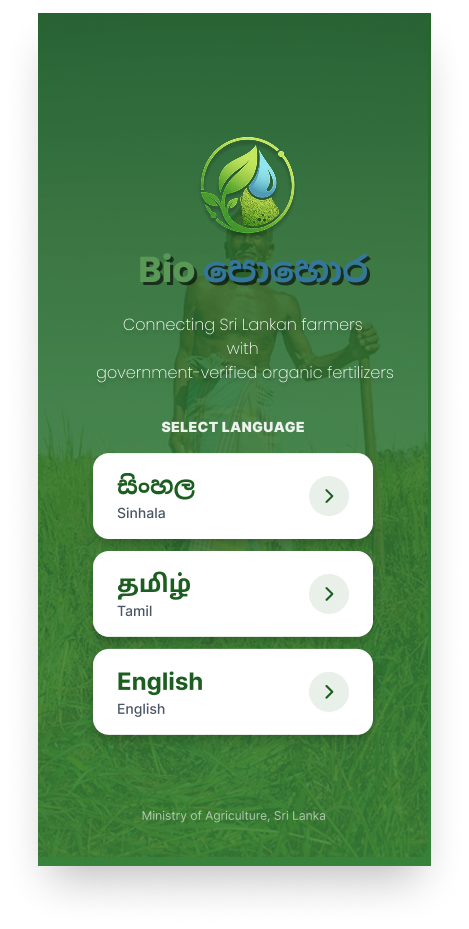
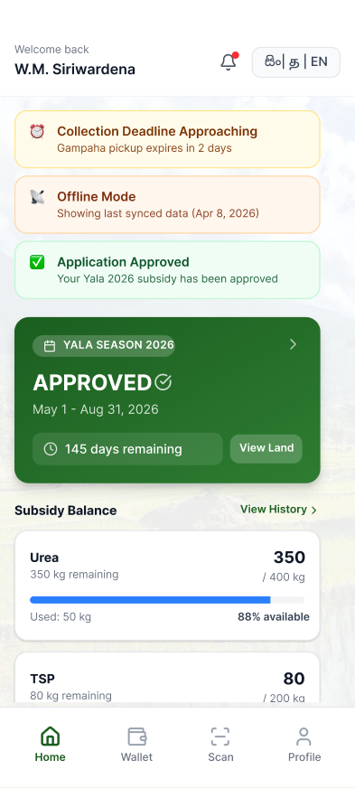
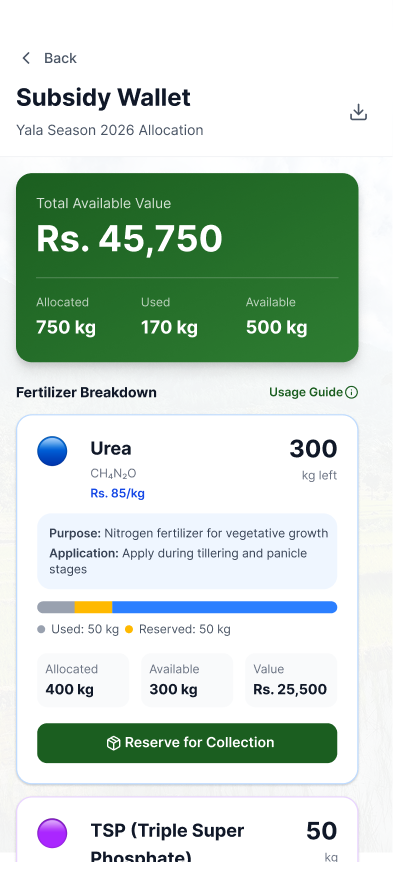
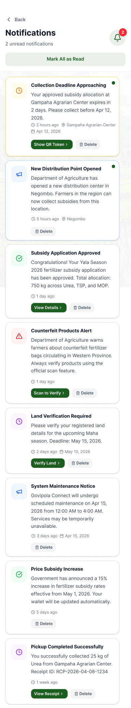
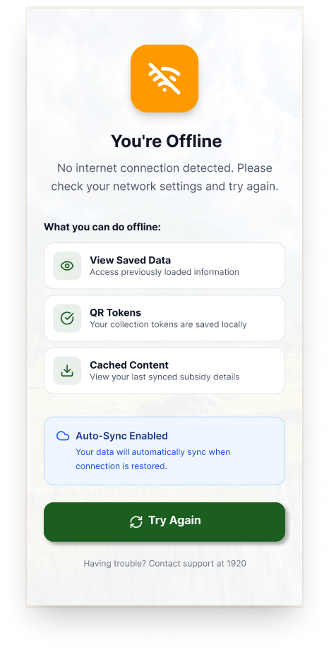
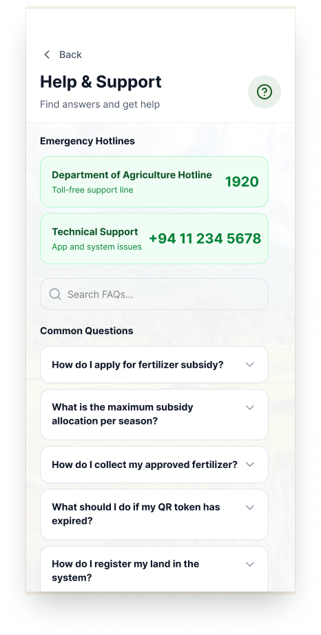
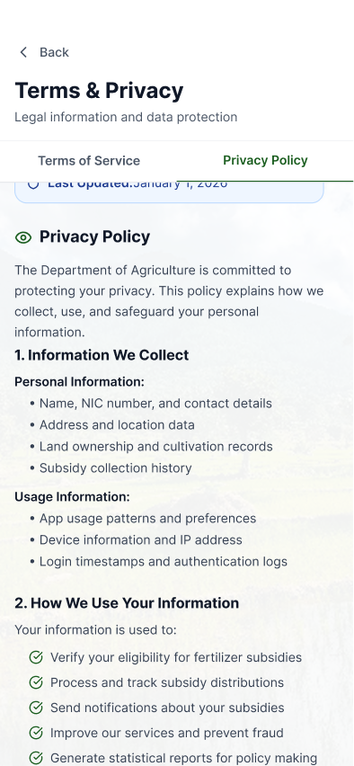
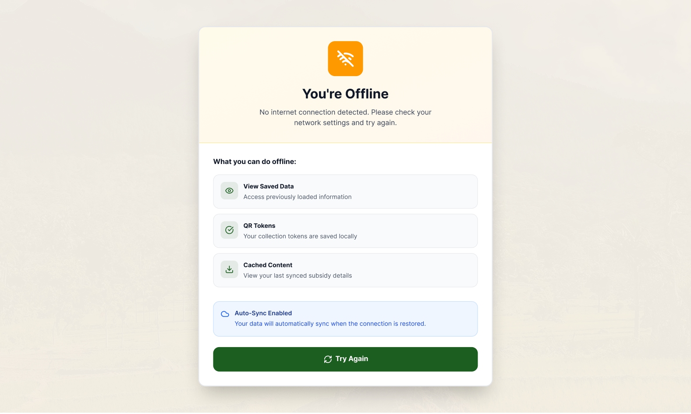

# BIO පොහොර

  <b>A Human-Centered Digital Agriculture Platform Modernizing Fertilizer Subsidy Distribution in Sri Lanka</b>

---

## 📌 Overview

**BIO පොහොර** is a mobile-first platform designed to modernize Sri Lanka's agricultural fertilizer subsidy system and improve transparency, accessibility, and accountability for farmers.

This project was developed as part of our **Human-Computer Interaction (HCI)** module and focuses on solving real-world challenges faced by farmers, government agencies, and local agriculture stakeholders.

---

## 📸 Interface & Prototype Showcase

### 📱 Farmer Mobile Application

Designed with an intuitive, trilingual, and accessible interface optimized for rural farmers under varying network conditions.

#### 1. Onboarding & Authentication
<table>
  <tr>
    <td align="center" width="33%">
       
      <b>Language Selection</b> 
      Trilingual support (Sinhala, Tamil, English)
    </td>
    <td align="center" width="33%">
       
      <b>Farmer Login</b> 
      Biometric & phone number authentication
    </td>
    <td align="center" width="33%">
       
      <b>Farmer Profile</b> 
      Farmer credentials & agrarian division details
    </td>
  </tr>
</table>

#### 2. Core Subsidy & Entitlement Management
<table>
  <tr>
    <td align="center" width="33%">
       
      <b>Home Dashboard</b> 
      Quick status, announcements & action shortcuts
    </td>
    <td align="center" width="33%">
       
      <b>Land & Eligibility</b> 
      Plot registration linked to quota calculation
    </td>
    <td align="center" width="33%">
       
      <b>Subsidy Wallet</b> 
      Transparent balance & fertilizer quota breakdown
    </td>
  </tr>
</table>

#### 3. Digital Token, Pickup & Notifications
<table>
  <tr>
    <td align="center" width="33%">
       
      <b>QR Subsidy Token</b> 
      Tamper-proof digital voucher for redemption
    </td>
    <td align="center" width="33%">
       
      <b>Pickup & History</b> 
      Depot pickup windows & past collection logs
    </td>
    <td align="center" width="33%">
       
      <b>Notifications & Alerts</b> 
      Expiry warnings & distribution updates
    </td>
  </tr>
</table>

#### 4. Offline Resilience & Support
<table>
  <tr>
    <td align="center" width="33%">
       
      <b>Offline Mode</b> 
      Cached tokens & offline-first accessibility
    </td>
    <td align="center" width="33%">
       
      <b>Help & Support</b> 
      Guidance, hotline & Agrarian Center assistance
    </td>
    <td align="center" width="33%">
       
      <b>Privacy & Policies</b> 
      Transparent farmer data rights & privacy
    </td>
  </tr>
</table>

<b>📄 View Additional Mobile Screens (Terms of Service)</b>

 
<table align="center">
  <tr>
    <td align="center" width="300">
       
      <b>Terms of Service</b> 
      Regulatory terms and usage guidelines
    </td>
  </tr>
</table>

---

### 🖥️ Agrarian Service Officer & Verification Portal

A dedicated desktop and tablet interface for Agrarian Service Center officers to issue, track, and verify fertilizer quotas in real time.

<table>
  <tr>
    <td align="center" width="50%">
       
      <b>Officer Secure Login</b> 
      Authorized government center access & role control
    </td>
    <td align="center" width="50%">
       
      <b>Officer Management Dashboard</b> 
      Regional distribution stats & farmer entitlement management
    </td>
  </tr>
  <tr>
    <td align="center" width="50%">
       
      <b>Token Verification Scanner</b> 
      Instant QR scanner validating entitlement & authentic stock
    </td>
    <td align="center" width="50%">
       
      <b>Officer Offline Distribution Mode</b> 
      Local depot caching with automated background sync
    </td>
  </tr>
</table>

---

## 🎯 Project Vision

The goal of **BIO පොහොර** is to transform the way fertilizer subsidies are managed and distributed by making the process digital, efficient, and trustworthy. The platform helps reduce fraud, prevent missed collections, improve communication, and give farmers better access to their entitlements.

---

## ⚠️ Problem Statement

Traditional fertilizer subsidy processes often suffer from:

- **Counterfeit or unauthorized fertilizer distribution**
- **Delays and missed collection deadlines**
- **Paper-based record keeping and administrative inefficiency**
- **Lack of transparency** in subsidy allocation and entitlement tracking
- **Poor communication** with farmers regarding deadlines and collection status

BIO පොහොර addresses these issues through a user-centered mobile experience designed for farmers in real agricultural contexts.

---

## 🚀 Key Features

### 1. QR Verification for Authentic Fertilizer
Farmers can verify the authenticity of fertilizer products using QR scanning, reducing counterfeit distribution and increasing trust in the supply chain.

### 2. Digital Token and Offline Sync
The system replaces unreliable paper-based processes with digital tokens and supports offline syncing, ensuring usability even in areas with limited connectivity.

### 3. Expiry and Collection Alerts
Users receive push notifications and expiry reminders to ensure they do not miss collection deadlines or overlook urgent updates.

### 4. Biometric Login
Secure and accessible authentication is provided through biometric login, enhancing trust and usability for farmers.

### 5. Land Plot Registration
Farmers can register and manage their land plots through the app, helping link entitlements to actual agricultural holdings.

### 6. Real-Time Wallet and Allocation Tracking
The platform provides transparent access to subsidy balances, fertilizer allocations, and farmer-specific entitlements.

### 7. Notification Management
Users are notified about deadlines, collection windows, and important agricultural updates in a timely and clear manner.

---

## 🌾 Why This Project Matters

BIO පොහොර brings digital innovation to a critical public service issue. It aims to:

- **Reduce fraud and misuse** of fertilizer subsidies
- **Improve trust** in government distribution systems
- **Make subsidy access transparent** for rural farmers
- **Reduce administrative burden** and paperwork for Agrarian Services
- **Support inclusive and accessible** digital agriculture services

---

## 🎨 Design Focus

This project was designed with a strong human-centered approach, emphasizing:

- **Simplicity for rural users** with minimal cognitive load
- **Clear, high-contrast, accessible UI** tailored for outdoor usage
- **Mobile usability in low-connectivity conditions** (offline-first design)
- **Farmer empowerment** through direct digital access to entitlements
- **Trust-building** through transparent system status and verification

---

## 👥 Project Team

**Project Leader:** Sahan Navo

**Team Members:**
- Sahan Weerasingha
- Oshadhi Purwa
- Sasindi Maneesha
- Charuka Amandi

---

## 💡 Reflection

Through this project, we gained practical experience in:

- User-centered design and UX thinking
- Design problem solving in real-world social systems
- Building accessible and practical digital experiences
- Collaboration, communication, and teamwork
- Translating policy needs into usable mobile and desktop interfaces

---

## 🛠️ Tools and Design Approach

The project was developed as a Figma-based design prototype and demonstrates a strong focus on interface design, user flows, and digital service modeling.

---

## 📈 Impact

BIO පොහොර is more than a design project; it represents a practical digital solution to improve the distribution of agricultural support in Sri Lanka. It focuses on making subsidy services more transparent, efficient, and farmer-friendly.

---

## 🤝 Acknowledgements

We would like to thank everyone who contributed to this project, especially our team members for their dedication, hard work, and collaboration throughout the design and development process.

---

## 🏷️ Tags

`#AgriTech` `#GovTech` `#UIUX` `#Figma` `#MobileAppDesign` `#DesignThinking` `#DigitalSriLanka` `#StudentProject` `#FarmersFirst` `#UXDesign`

---

## 📝 Note

This repository contains the project information and design assets for BIO පොහොර, created as part of our university project work.
